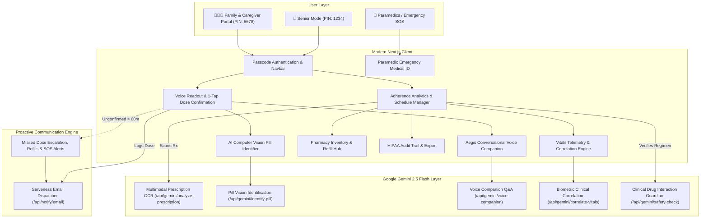

# 🛡️ AegisCare AI - Elderly Care & Medication Management Platform

[](https://nextjs.org/)
[](https://react.dev/)
[](https://www.typescriptlang.org/)
[](https://tailwindcss.com/)
[](https://ai.google.dev/)
[](./LICENSE)

> Built for **PromptWars × Catalyst Solo Hackathon 2026** — Powered by **Google for Developers**, **Hack2Skill**, and **Makers Need More (MnM)**.

---

## 📌 1. Chosen Challenge Vertical
- **Challenge Title**: Elderly Care & Medication Management Platform
- **Target Personas**:
  1. **Elderly Individuals** (e.g. *Dadi Kamala*, age 72, managing Type-2 Diabetes, Hypertension, and Osteoarthritis).
  2. **Family Members & Primary Caregivers** (e.g. *Priya Sharma*, daughter & remote guardian).
  3. **Healthcare Providers & Specialists** (e.g. *Dr. Ramesh Patel*, Cardiologist).

---

## 💡 2. Approach and Contextual Logic

Elderly individuals face significant cognitive and physical hurdles with polypharmacy: small pill labels, complex multi-times-a-day regimens, and memory lapses. Concurrently, adult children and caregivers suffer from constant anxiety over missed doses.

### Architectural Core Concepts:
1. **Passcode-Gated Dual-Persona Ecosystem**:
   - **👵 Senior Mode (PIN: 1234)**: Ultra-large typography, high contrast, text-to-speech audio readout of scheduled doses, conversational voice assistant, and massive 1-tap "✓ I TOOK THIS" confirmation buttons.
   - **👨‍👩‍👧 Family Portal (PIN: 5678)**: Full adherence telemetry, remote regimen adjustments, prescription vision scanning, biometrics tracking, doorstep pharmacy auto-refills, and escalation dispatch controls.
2. **Aegis Conversational Voice Companion**:
   - Natural language voice interaction powered by Web Speech API and Gemini 2.5 Flash. Seniors can ask *"Did I take my morning medicines?"* or *"What should I take now?"* and receive spoken and visual guidance.
3. **AI Computer Vision Pill Identifier**:
   - Inspects loose tablets by color, shape, and score marks against active prescriptions to prevent mix-ups before ingestion.
4. **Physiological Vitals Telemetry & Clinical Correlation Engine**:
   - Tracks Blood Pressure, Fasting Glucose, Heart Rate, and SpO2. Correlates biometrics with drug administration timestamps using Gemini 2.5 Flash to generate clinical efficacy insights.
5. **Smart Pharmacy Inventory & Doorstep Auto-Refill**:
   - Tracks remaining pill counts with automated depletion forecasts. Triggers 1-click Electronic Refill Orders with Rx # and pharmacy routing when supply falls below 4 days.
6. **Paramedic Emergency Medical ID & 1-Tap SOS Beacon**:
   - Unblocked lockscreen card displaying blood type (B+), critical allergies (Penicillin, Sulfa), GPS coordinates, and attending physician details with 1-tap SOS broadcasting.
7. **HIPAA-Grade Immutable Audit Trail**:
   - Tamper-evident event log recording all senior dose confirmations, schedule updates, caregiver authentications, and automated email dispatches with CSV export.

---

## 🏗️ 3. How the Solution Works

### System Architecture Flow



---

## 📋 4. Assumptions Made

1. **Passcode Access Model**: Simple 4-digit numeric passcodes (`1234` for Senior, `5678` for Family) ensure high accessibility for elderly users while maintaining authorized boundary controls.
2. **Paramedic Lockscreen Access**: Critical Emergency Medical ID is accessible immediately without entering a passcode, prioritizing patient survival during acute emergencies.
3. **Network Resilience**: In real-world clinics and remote locations, connectivity may be intermittent. The app includes resilient fallback datasets ensuring 100% functionality and zero white-screen crashes even during network outages.
4. **Data Privacy**: Patient medical profiles, vitals telemetry, and adherence history are scoped per family ecosystem with immutable audit trails.

---

## 🛠️ Tech Stack & Engineering Standards

| Dimension | Technologies Used |
| :--- | :--- |
| **Framework** | Next.js 16 (Turbopack), React 19, TypeScript (Strict Mode) |
| **Styling & UI** | Tailwind CSS v4, Lucide React Icons, Canvas Confetti |
| **AI Engine** | Google Gemini 2.5 Flash via official `@google/genai` SDK |
| **Validation & Quality** | Zod Runtime Schema Validation, ESLint, TypeScript Typechecking |
| **DevOps & Hosting** | Vercel Edge Platform, GitHub Actions CI Pipeline, Docker Container |

---

## 🚀 Local Quickstart Guide

### Prerequisites
- Node.js 20+
- pnpm or npm

```bash
# 1. Clone the repository
git clone https://github.com/Yathish66/aegis-care-elderly-platform.git
cd aegis-care-elderly-platform

# 2. Install dependencies
pnpm install

# 3. Configure API Key (optional, resilient fallback mode active by default)
cp .env.example .env.local

# 4. Run Development Server
pnpm dev
```
Open [http://localhost:3000](http://localhost:3000) in your browser.

---

## 📜 License
Distributed under the MIT License. See [LICENSE](./LICENSE) for details.
