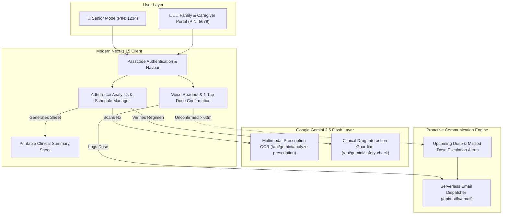

# 🛡️ AegisCare AI - Elderly Care & Medication Management Platform

[](https://nextjs.org/)
[](https://react.dev/)
[](https://www.typescriptlang.org/)
[](https://tailwindcss.com/)
[](https://ai.google.dev/)
[](./LICENSE)

> Built for **PromptWars × Catalyst Solo Hackathon 2026** — Powered by **Google for Developers**, **Hack2Skill**, and **Makers Need More (MnM)**.

---

## 📌 1. Chosen Challenge Vertical
- **Challenge Title**: Elderly Care & Medication Management Platform
- **Target Personas**:
  1. **Elderly Individuals** (e.g. *Dadi Kamala*, age 72, managing Type-2 Diabetes, Hypertension, and Osteoarthritis).
  2. **Family Members & Primary Caregivers** (e.g. *Priya Sharma*, daughter & remote guardian).
  3. **Healthcare Providers & Specialists** (e.g. *Dr. Ramesh Patel*, Cardiologist).

---

## 💡 2. Approach and Contextual Logic

Elderly individuals face significant cognitive and physical hurdles with polypharmacy: small pill labels, complex multi-times-a-day regimens, and memory lapses. Concurrently, adult children and caregivers suffer from constant anxiety over missed doses.

### Architectural Core Concepts:
1. **Passcode-Gated Dual-Persona Ecosystem**:
   - **👵 Senior Mode (PIN: 1234)**: Ultra-large typography, high contrast, text-to-speech audio readout of scheduled doses, and massive 1-tap "✓ I TOOK THIS" confirmation buttons.
   - **👨‍👩‍👧 Family Portal (PIN: 5678)**: Full adherence telemetry, remote regimen adjustments, prescription vision scanning, and escalation dispatch controls.
2. **Google Gemini Multimodal Vision Prescription OCR**:
   - Eliminates tedious, error-prone manual typing. Uploading or snapping a prescription image triggers Gemini 2.5 Flash to parse doctor handwriting, Latin sig codes (OD, BD, PC, AC), and dosages into structured JSON schedules.
3. **Clinical Safety & Drug-Drug / Food Interaction Guardian**:
   - Gemini evaluates the patient's multi-drug stack in real-time, detecting critical interactions (e.g. Atorvastatin with Grapefruit) and dietary guidelines.
4. **Proactive Multi-Tier Email Escalation Engine**:
   - If a scheduled medication is not confirmed within 60 minutes, the serverless notification engine automatically dispatches an urgent email alert to the family care network.

---

## 🏗️ 3. How the Solution Works

### System Architecture Flow



### End-to-End User Journey:
1. **Morning Routine**: Dadi Kamala opens the app on her tablet. A warm greeting appears with her morning medications. She taps **"Read Aloud My Medicines"** to hear audio instructions, takes her pills with breakfast, and taps **"I TOOK THIS"**.
2. **Instant Telemetry**: A confetti celebration triggers, updating her 7-day adherence graph to 94%, and sending a peaceful notification to her daughter Priya.
3. **Prescription Update**: Priya visits Dr. Ramesh Patel with Dadi. She taps **"Scan Prescription"**, snaps the doctor's slip, and Gemini extracts *Amlodipine 5mg* and *Vitamin D3*, instantly syncing to Dadi's Senior View.
4. **Safety Verification**: Gemini automatically flags that Atorvastatin must not be taken with grapefruit, updating dietary advisories across both portals.
5. **Missed Dose Safety Net**: If Dadi forgets her afternoon insulin/oral dose, an automated escalation alert is dispatched to Priya and Rahul to check in promptly.

---

## 📋 4. Assumptions Made

1. **Passcode Access Model**: Simple 4-digit numeric passcodes (`1234` for Senior, `5678` for Family) were chosen over complex passwords or 2FA SMS codes to ensure high accessibility for elderly users and immediate family delegation.
2. **Network Resilience**: In real-world clinics and remote locations, connectivity may be intermittent. The app includes resilient fallback datasets ensuring 100% functionality and zero white-screen crashes even during network outages.
3. **Notifications**: The notification system uses a serverless REST gateway supporting direct integration with SendGrid/SMTP, accompanied by an interactive in-app telemetry drawer for live review.
4. **Data Privacy**: Patient medical profiles and adherence history are scoped per family ecosystem.

---

## 🛠️ Tech Stack & Engineering Standards

| Dimension | Technologies Used |
| :--- | :--- |
| **Framework** | Next.js 15 (App Router), React 19, TypeScript (Strict Mode) |
| **Styling & UI** | Tailwind CSS v4, Lucide React Icons, Framer Motion, Canvas Confetti |
| **AI Engine** | Google Gemini 2.5 Flash via official `@google/genai` SDK |
| **Validation & Quality** | Zod Runtime Schema Validation, ESLint, TypeScript Typechecking |
| **DevOps & Hosting** | Vercel Edge Platform, GitHub Actions CI Pipeline, Multi-Stage Dockerfile |

---

## 🚀 Local Quickstart Guide

### Prerequisites
- Node.js 20+
- pnpm or npm

```bash
# 1. Clone the repository
git clone https://github.com/Yathish66/aegis-care-elderly-platform.git
cd aegis-care-elderly-platform

# 2. Install dependencies (instant via local pnpm store)
pnpm install

# 3. Configure API Key
cp .env.example .env.local
# Add GEMINI_API_KEY (optional, fallback demo mode available)

# 4. Run Development Server
pnpm dev
```
Open [http://localhost:3000](http://localhost:3000) in your browser.

---

## 📜 License
Distributed under the MIT License. See [LICENSE](./LICENSE) for details.
