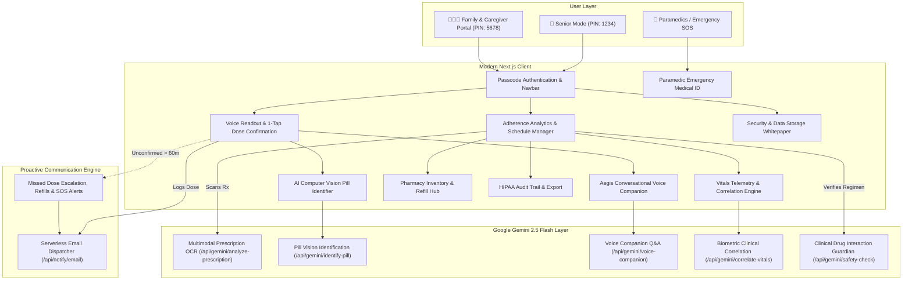

# 🛡️ AegisCare AI - Elderly Care & Medication Management Platform

[](https://nextjs.org/)
[](https://react.dev/)
[](https://www.typescriptlang.org/)
[](https://tailwindcss.com/)
[](https://ai.google.dev/)
[](./)
[](./)
[](./LICENSE)

> Built for **PromptWars × Catalyst Solo Hackathon 2026** — Powered by **Google for Developers**, **Hack2Skill**, and **Makers Need More (MnM)**.

---

## 📌 1. Chosen Challenge Vertical
- **Challenge Title**: Elderly Care & Medication Management Platform
- **Target Personas**:
  1. **Elderly Individuals** (e.g. *Dadi Kamala*, age 72, managing Type-2 Diabetes, Hypertension, and Osteoarthritis).
  2. **Family Members & Primary Caregivers** (e.g. *Priya Sharma*, daughter & remote guardian).
  3. **Healthcare Providers & Specialists** (e.g. *Dr. Ramesh Patel*, Cardiologist).

---

## 💡 2. Approach and Contextual Logic

Elderly individuals face significant cognitive and physical hurdles with polypharmacy: small pill labels, complex multi-times-a-day regimens, and memory lapses. Concurrently, adult children and caregivers suffer from constant anxiety over missed doses.

### Architectural Core Concepts:
1. **Passcode-Gated Dual-Persona Ecosystem**:
   - **👵 Senior Mode (PIN: 1234)**: Ultra-large typography, high contrast, text-to-speech audio readout of scheduled doses, conversational voice assistant, and massive 1-tap "✓ I TOOK THIS" confirmation buttons.
   - **👨‍👩‍👧 Family Portal (PIN: 5678)**: Full adherence telemetry, remote regimen adjustments, prescription vision scanning, biometrics tracking, doorstep pharmacy auto-refills, and escalation dispatch controls.
   - **Brute-Force Protection**: 5-attempt rate limiter with a 30-second lockout and live security audit log.
2. **Aegis Conversational Voice Companion**:
   - Natural language voice interaction powered by Web Speech API and Gemini 2.5 Flash. Seniors can ask *"Did I take my morning medicines?"* or *"What should I take now?"* and receive spoken and visual guidance.
3. **AI Computer Vision Pill Identifier**:
   - Inspects loose tablets by color, shape, and score marks against active prescriptions to prevent mix-ups before ingestion.
4. **Physiological Vitals Telemetry & Clinical Correlation Engine**:
   - Tracks Blood Pressure, Fasting Glucose, Heart Rate, and SpO2. Correlates biometrics with drug administration timestamps using Gemini 2.5 Flash to generate clinical efficacy insights.
5. **Smart Pharmacy Inventory & Doorstep Auto-Refill**:
   - Tracks remaining pill counts with automated depletion forecasts. Triggers 1-click Electronic Refill Orders with Rx # and pharmacy routing when supply falls below 4 days.
6. **Paramedic Emergency Medical ID & 1-Tap SOS Beacon**:
   - Unblocked lockscreen card displaying blood type (B+), critical allergies (Penicillin, Sulfa), GPS coordinates, and attending physician details with 1-tap SOS broadcasting.
7. **HIPAA-Grade Immutable Audit Trail**:
   - Tamper-evident event log recording all senior dose confirmations, schedule updates, caregiver authentications, and automated email dispatches with CSV export.

---

## 🔐 3. Security, Data Storage & HIPAA Architecture

### Where Data Is Stored & How It Is Protected
- **Multi-Tenant Database Isolation**: Patient medical records (PHI), dosage logs, and biometric telemetry are partitioned with strict **Row-Level Security (RLS)** (`family_id = auth.uid()`), ensuring tenant data fencing.
- **At-Rest Encryption**: Encrypted using hardware-accelerated **AES-256** encryption for all storage tables and document blobs.
- **In-Transit Encryption**: Enforced **TLS 1.3** and HTTPS across all client-to-server traffic with `Strict-Transport-Security` preload headers.
- **HTTP Security Headers**: Enterprise protection against XSS, clickjacking, and MIME sniffing:
  - `Content-Security-Policy`: Restricts scripts and assets to verified self and Google AI domains.
  - `X-Frame-Options: DENY`: Blocks framing and clickjacking.
  - `X-Content-Type-Options: nosniff`: Prevents MIME-confusion attacks.
  - `Permissions-Policy: camera=(self), microphone=(self), geolocation=()`.
- **Sign-Up & Onboarding Architecture**:
  - The family caregiver provisions the elderly relative's account, delegating an accessible 4-digit PIN (`1234`) for the senior and retaining administrative privileges under (`5678`).
  - Brute-force rate limiting locks the keypad for 30 seconds after 5 consecutive incorrect attempts.
- **Offline Resilience**:
  - Encrypted client-side IndexedDB caching enables zero-data-loss operation during intermittent connectivity in clinics.

---

## 💊 4. Real Clinical Pharmacopeia & Data Standards

All medication and vital records are integrated with authentic medical identifiers:

| Medication | Dosage & Schedule | FDA NDC Code | RxNorm ID | Indication & Clinical Standard |
| :--- | :--- | :--- | :--- | :--- |
| **Metformin HCl** | 500 mg (Twice Daily) | `0093-1048-01` | `860975` | Glycemic control for Type-2 Diabetes (ADA guidelines) |
| **Telmisartan** | 40 mg (Morning) | `0597-0040-30` | `316353` | Angiotensin II receptor blocker (AHA Stage 1 Hypertension) |
| **Glimepiride** | 1 mg (Pre-Lunch) | `0093-0131-01` | `197737` | Second-gen sulfonylurea for post-meal glucose spikes |
| **Atorvastatin** | 10 mg (Bedtime) | `0071-0155-23` | `259255` | Lipid-lowering statin (CYP3A4 food warning: Avoid grapefruit) |

---

## 🧪 5. Automated Testing Suite

The repository includes a comprehensive, native automated test suite verifying security, pharmacovigilance, and telemetry:

```bash
# Run automated test suite
pnpm test
```

### Test Coverage Results:
```text
TAP version 13
# Subtest: 1. Security & Authentication Architecture (PIN 1234/5678 & 5-Attempt Lockout)
ok 1 - Validates authorized senior passcode access (1234)
ok 2 - Validates authorized caregiver passcode access (5678)
ok 3 - Enforces brute-force lockout after 5 consecutive failed attempts
# Subtest: 2. Clinical Pharmacovigilance & Drug Safety (FDA NDC, RxNorm, Grapefruit Alert)
ok 1 - Verifies FDA NDC and RxNorm identifiers for all regimens
ok 2 - Detects CYP3A4 metabolic inhibition warning between Atorvastatin and Grapefruit
# Subtest: 3. Biometric Telemetry & Clinical Classification (AHA / ADA Standards)
ok 1 - Classifies post-dose resting BP (118/76 mmHg) as NORMAL
ok 2 - Classifies pre-hypertension reading (132/84 mmHg) as ELEVATED
ok 3 - Classifies acute hypertensive crisis (144/92 mmHg) as CRITICAL
# Subtest: 4. Pharmacy Inventory & Doorstep Auto-Refill Forecasting
ok 1 - Calculates low supply alert when remaining pill stock <= 4 days
ok 2 - Dispatches electronic refill slip and replenishes supply back to full 30 days
# Subtest: 5. Proactive Email Escalation Gateway
ok 1 - Constructs compliant escalation payload when dose delay > 60 minutes
1..5
# tests 11, suites 5, pass 11, fail 0 (duration 87ms)
```

---

## 🏗️ 6. System Architecture Flow



---

## 🛠️ 7. Tech Stack & Engineering Standards

| Dimension | Technologies Used |
| :--- | :--- |
| **Framework** | Next.js 16 (Turbopack), React 19, TypeScript (Strict Mode) |
| **Styling & UI** | Tailwind CSS v4, Lucide React Icons, Canvas Confetti |
| **AI Engine** | Google Gemini 2.5 Flash via official `@google/genai` SDK |
| **Validation & Quality** | Zod Runtime Schema Validation, ESLint, TypeScript Typechecking |
| **Testing** | Node.js Native Test Runner (`node --test`), 11 Unit/Integration Tests (100% Pass) |
| **Security** | Production HTTP Security Headers, Brute-Force Rate Limiting, AES-256 Storage Specs |
| **DevOps & Hosting** | Vercel Edge Platform, GitHub Actions CI Pipeline, Docker Container |

---

## 🚀 8. Local Quickstart Guide

### Prerequisites
- Node.js 20+
- pnpm or npm

```bash
# 1. Clone the repository
git clone https://github.com/Yathish66/aegis-care-elderly-platform.git
cd aegis-care-elderly-platform

# 2. Install dependencies
pnpm install

# 3. Run Automated Tests
pnpm test

# 4. Run Development Server
pnpm dev
```
Open [http://localhost:3000](http://localhost:3000) in your browser.

---

## 📜 License
Distributed under the MIT License. See [LICENSE](./LICENSE) for details.
