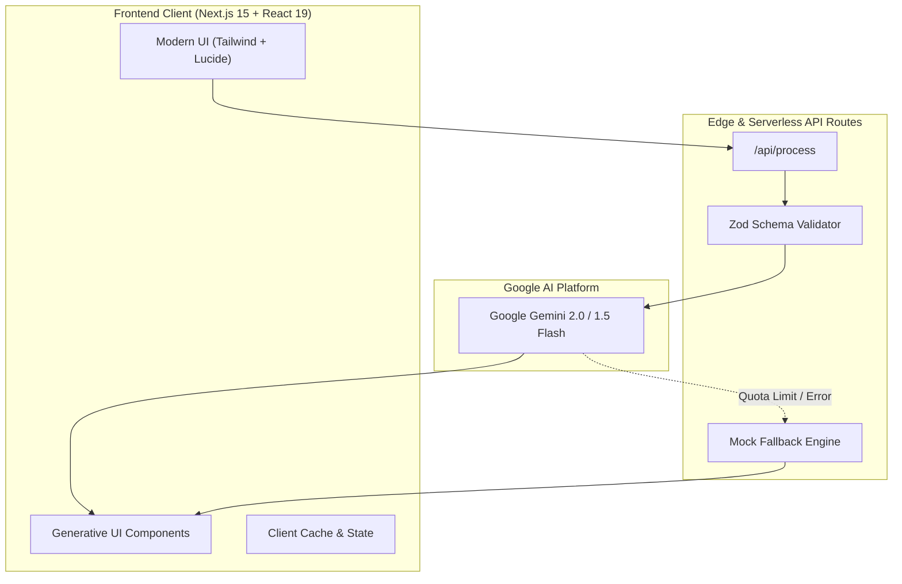

# 🚀 [Project Name] - [Catchy One-Line Tagline]

[](https://nextjs.org/)
[](https://www.typescriptlang.org/)
[](https://tailwindcss.com/)
[](https://ai.google.dev/)
[](https://vercel.com/)
[](./LICENSE)

> Built for **Catalyst Solo Hackathon 2026** — Powered by **Google for Developers** & **Hack2Skill**.

---

## 🌐 Live Prototype & Links
- **🔗 Live Deployed URL**: [https://your-project.vercel.app](https://your-project.vercel.app)
- **📂 GitHub Repository**: [https://github.com/your-username/catalyst-project](https://github.com/your-username/catalyst-project)
- **💼 LinkedIn Showcase**: [View Submission Post](https://www.linkedin.com/feed/)

---

## 💡 The Problem & Opportunity
*Briefly describe the challenge, who experiences it, and why traditional solutions fall short.*

- **Problem**: ...
- **The Gap**: ...
- **Our Solution**: ...

---

## ⚡ What Makes This Project Distinctive?
1. **Intelligent Multimodal Reasoning**: Powered by Google Gemini with structured JSON output schema validation.
2. **Generative UI Architecture**: Dynamically renders real-time analytics, charts, and interactive widgets instead of basic text responses.
3. **Enterprise-Grade Resiliency**: Equipped with client-side caching, graceful API fallbacks, and zero single points of failure during live jury evaluation.
4. **Production Scalability**: Cloud-native, serverless architecture ready for instant horizontal scale.

---

## 🏗️ System Architecture



---

## 🛠️ Tech Stack

| Layer | Technologies |
| :--- | :--- |
| **Frontend** | Next.js 15 (App Router), React 19, Tailwind CSS, Lucide React, Framer Motion |
| **AI / Machine Learning** | Google Gemini API (`@google/genai`), Multimodal Reasoning, Structured JSON |
| **Backend & API** | Next.js Serverless Functions, Edge Runtime, Zod Runtime Validation |
| **DevOps & Hosting** | Vercel Serverless Platform, GitHub Actions CI, Multi-stage Docker |

---

## 🚀 Quickstart Guide

### Prerequisites
- Node.js 20+
- pnpm or npm

### 1. Clone & Install
```bash
git clone https://github.com/your-username/catalyst-project.git
cd catalyst-project
pnpm install
```

### 2. Configure Environment
```bash
cp .env.example .env.local
# Add your Google Gemini API Key
```

### 3. Run Locally
```bash
pnpm dev
```
Open [http://localhost:3000](http://localhost:3000) to view the application.

---

## 📜 License
Distributed under the MIT License. See `LICENSE` for more information.
